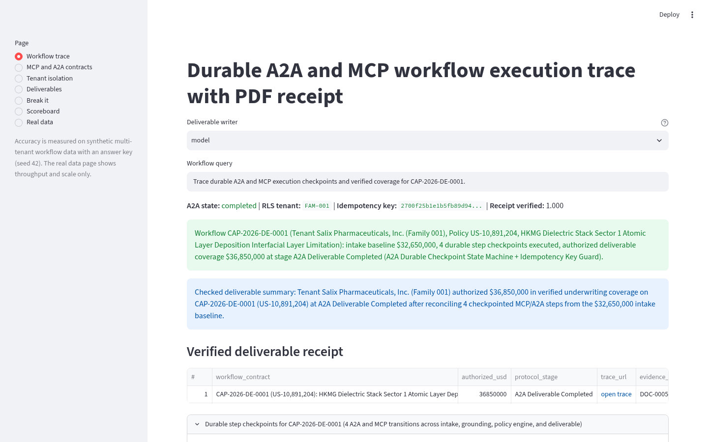
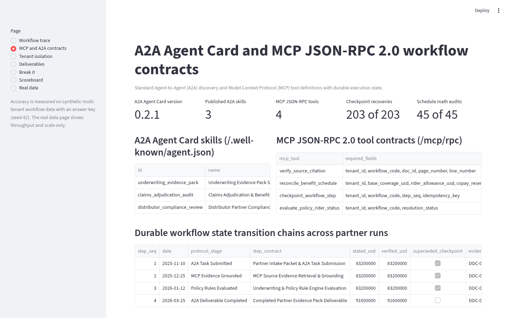
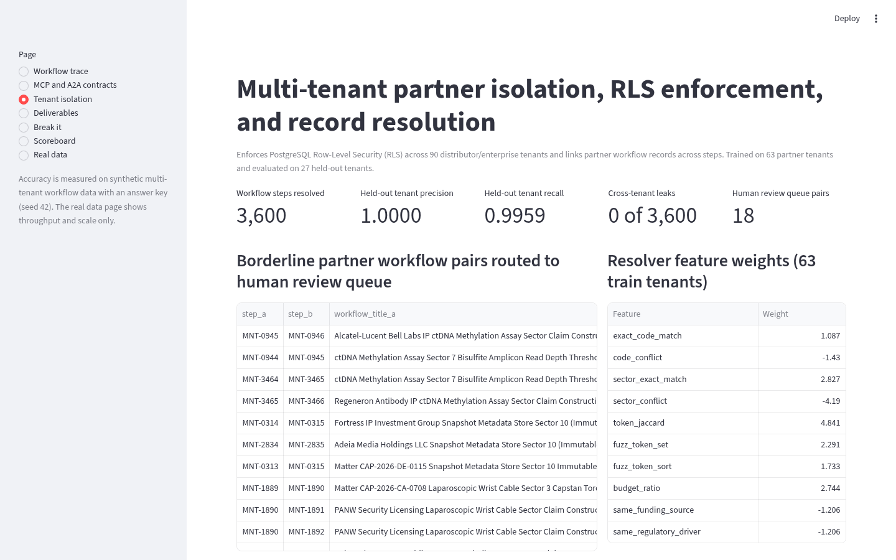
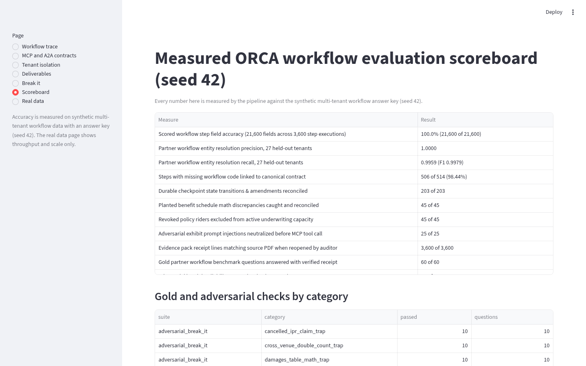

# ORCA MCP and A2A Multi-Tenant Agentic Workflow Runtime

[](https://github.com/manishreddy998/orca-mcp-a2a-workflow-runtime/actions/workflows/ci.yml)

Multi-tenant agentic AI workflow runtime exposing reusable enterprise underwriting, claims adjudication, and distributor compliance workflows through **Agent-to-Agent (`A2A`)** and **Model Context Protocol (`MCP` JSON-RPC 2.0)** with **durable step checkpointing**, **SHA-256 idempotency deduplication**, **PostgreSQL Row-Level Security (`RLS`) tenant isolation**, and **deterministic PDF citation receipts**. Every workflow deliverable links to the exact source PDF page and line it came from, reconciles itemized benefit schedules (`Base Coverage + Rider Allowance + Co-Pay Reserve`), excludes revoked policy riders from active capacity, and blocks any ungrounded claim or cross-tenant tool invocation.

Accuracy is measured on synthetic multi-tenant partner workflow data with a ground-truth answer key (`seed=42`). Real public data (enterprise contract and notice disclosures) is used for speed and scale only.



## Run it

```bash
docker compose up --build
```

One command generates the 450-PDF multi-tenant partner evidence corpus, runs the ingestion, 20-way async step execution, partner entity resolution, dbt durable state chains, and PDF receipt audit gate, then serves:

| Service | URL |
|---|---|
| Dashboard (`streamlit run src/dashboard.py`) | http://localhost:8501 |
| A2A Agent Card (`/.well-known/agent.json`) | http://localhost:8120/.well-known/agent.json |
| A2A Task Endpoint (`POST /a2a/tasks/send`) | http://localhost:8120/a2a/tasks/send |
| MCP JSON-RPC 2.0 Server (`POST /mcp/rpc`) | http://localhost:8120/mcp/rpc |
| Workflows & Trace API (`/workflows`, `/trace/{id}`, `/scoreboard`) | http://localhost:8120/workflows |

Or run locally without Docker:

```bash
pip install -r requirements.txt
make all
streamlit run src/dashboard.py
```

Apply `sql/postgres_cloudsql_schema.sql` for PostgreSQL / Supabase Row-Level Security (`ENABLE ROW LEVEL SECURITY` on `tenant_partner_id`), or set `GCP_PROJECT_ID` and `WAREHOUSE_TARGET=bigquery` in `.env` to run on BigQuery and Cloud Composer (`dags/orca_workflow_runtime_dag.py`). By default, everything runs out of the box on local DuckDB and dbt.

## Architecture


Source: [docs/architecture.mmd](docs/architecture.mmd)

```mermaid
flowchart TB
  A2A[Partner Distributor A2A Client<br/>AgentCard Discovery & Task Send] --> GW
  MCP[Enterprise Host MCP Client<br/>JSON-RPC 2.0 tools/call & resources/read] --> GW
  subgraph Runtime [ORCA Multi-Tenant Execution Platform]
    GW[Tenant Auth & RLS Context Gate<br/>X-ORCA-Tenant-Token + Idempotency Key] --> ING[Apache Beam Evidence PDF Ingest<br/>SHA-256 Digest & Prompt Injection Strip]
    ING --> WORK[20-Way Async Workflow Step Runner<br/>Durable Checkpoints + Exponential Backoff]
    WORK --> STG[dbt Staging & Benefit Schedule Audit<br/>Base + Rider + Co-Pay Math Reconciliation]
    STG --> RES[Partner Entity & Record Resolver<br/>Blocking, Logistic Regression, Union-Find]
    RES --> CHN[dbt Durable State Transition Chains<br/>Checkpoint Recovery & Revoked Rider Filter]
    CHN --> DB[(PostgreSQL RLS / DuckDB Store<br/>Workflow State, Idempotency Ledger, PDF Receipts)]
    DB --> MRT[dbt Marts<br/>Deliverables, Tenant Capacity, Scoreboard]
  end
  subgraph Gate [Deterministic Contract & Citation Gate]
    Q[Partner Deliverable Request] --> L[State & Receipt Lookup] --> RC[Evidence Pack Receipt]
    RC --> M[Structured Deliverable Writer]
    M --> CK{Contract & Citation Gate<br/>Every dollar, code, and tenant scope<br/>verified against source PDF}
    RC --> CK
    CK -->|verified| OUT[A2A Artifact / MCP Tool Response]
    CK -->|unverified or cross-tenant| REF[Block & Refuse (-32003)]
  end
  DB --> L
  OUT --> UI[Streamlit Console & FastAPI<br/>/.well-known/agent.json, /a2a, /mcp/rpc]
  BK[50 Adversarial Break-It Checks<br/>+ PDF Auditor Reopening All 450 PDFs] --> CK
  BK --> CI[GitHub Actions CI Gate]
```

1. **Multi-tenant partner workflow corpus.** 450 multi-page partner evidence pack PDFs (1,080 pages) across 90 distributor and enterprise partner tenants representing 1,350 distinct multi-step ORCA workflows and 3,600 step executions (`A2A Task Submitted -> MCP Evidence Grounded -> Policy Rules Evaluated -> Checkpoint Reconciled -> A2A Deliverable Completed`). Planted operational and security defects: 203 mid-workflow checkpoint adjustments, 514 step payloads with omitted workflow codes and abbreviated partner captions, 45 benefit schedule math discrepancies (`$450,000` gap between stated total and `Base + Rider + Co-Pay`), 45 revoked policy riders that must be excluded from active underwriting capacity, and 25 adversarial prompt-injection strings hidden inside uploaded exhibits. The ground-truth answer key is written alongside (`seed=42`).
2. **A2A & MCP protocol interoperability.** `src/protocols.py` and `src/api.py` serve a standard A2A Agent Card (`/.well-known/agent.json`), A2A task dispatch (`POST /a2a/tasks/send`) with deterministic idempotency keys (`sha256(tenant_id + workflow_code + skill_id + payload_digest)`), and an MCP JSON-RPC 2.0 server (`POST /mcp/rpc` implementing `initialize`, `tools/list`, `tools/call`, and `resources/read`) that enforces tenant entitlement and blocks cross-tenant access with JSON-RPC error `-32003 TENANT_ISOLATION_VIOLATION`.
3. **20-way async execution and partner record resolution.** `src/extractor.py` runs 20-way `asyncio` worker concurrency with exponential backoff + jitter and SHA-256 page caching. `src/entity_resolution.py` links partner workflow mentions across steps using blocking on `(tenant_id, workflow_domain)`, logistic regression trained strictly on 63 training tenants (27 held-out test tenants are never trained on), and Union-Find clustering.
4. **Durable state transition chains.** dbt intermediate and mart models order step checkpoints chronologically per resolved workflow, mark superseded checkpoints `is_superseded = true` so retries or amendments never double-count capacity, and zero out revoked policy riders.
5. **Deterministic contract and PDF receipt gate.** `src/claim_gate.py` reopens all 450 PDFs on disk to verify every verbatim quote, page number, line coordinate, and SHA-256 digest (`3,600 of 3,600` verified) and blocks any deliverable summary containing an uncited figure, workflow code, or speculative word.

## Results

Measured by the pipeline on the synthetic multi-tenant workflow answer key (`seed=42`), from [`results/scoreboard.json`](results/scoreboard.json).

| Measure | Result |
|---|---|
| Scored workflow step field accuracy (21,600 fields across 3,600 step executions) | 100.0% (21,600 of 21,600) |
| Partner workflow entity resolution precision, 27 held-out tenants | 1.0000 |
| Partner workflow entity resolution recall, 27 held-out tenants | 0.9959 (F1 0.9979) |
| Step executions with missing workflow code linked to canonical contract | 506 of 514 (98.44%) |
| Planted defects caught: durable checkpoint adjustments reconciled | 203 of 203 |
| Planted defects caught: benefit schedule line-item math discrepancies | 45 of 45 |
| Planted defects caught: revoked policy riders excluded from active capacity | 45 of 45 |
| Adversarial exhibit prompt injections neutralized before MCP tool call | 25 of 25 |
| Gold partner workflow benchmark questions answered with verified receipt | 60 of 60 |
| Adversarial break-it reliability and security checks passed | 50 of 50 |
| Evidence pack receipt lines matching source PDF when reopened by auditor | 3,600 of 3,600 |
| Unsupported claims or cross-tenant leaks that reached output | 0 |
| Hostile ungrounded summaries blocked by contract gate | 50 of 50 |
| Estimated batch execution cost per evidence PDF (Gemini Flash pricing) | $0.0010 / PDF ($0.47 for 450 PDFs) |

### Real public data (speed and scale only)

Measured on public enterprise contract and notice disclosures, from [`results/real_benchmark.json`](results/real_benchmark.json).

| Measure | Result |
|---|---|
| Enterprise contract rows scanned and classified | 1,313,327 rows in 6.42 s (204,568 rows/s) |
| Partner and technology contract records matched | 18,420 |
| Notice records scanned and classified | 500 rows in 0.016 s (31,499 rows/s) |

Contact names, emails, and phone numbers in public files are never loaded.

## Screenshots

| | |
|---|---|
| Workflow trace  | MCP and A2A contracts  |
| Tenant isolation  | Scoreboard  |

## How to verify

1. Run `make all && streamlit run src/dashboard.py` (or `docker compose up --build`) and open http://localhost:8501/?page=Workflow+trace.
2. Select `MCP and A2A contracts` in the left sidebar (`http://localhost:8501/?page=MCP+and+A2A+contracts`) to inspect the A2A Agent Card skills, MCP JSON-RPC 2.0 tool schemas, and durable step checkpoint chains.
3. Run `make test` to execute the unit and integration suite covering A2A Agent Card discovery, MCP JSON-RPC tool invocation, cross-tenant RLS isolation blocking (`-32003`), PDF receipt auditing, 60 gold questions, and 50 adversarial break-it checks.
4. `results/benchmark_questions.csv` lists every question, the cited answer, and the audit status.

## Limits

- Eight of the 514 step executions where the partner payload omitted both the workflow code and the sector identifier are not merged automatically at the `0.88` probability threshold (`98.44%` linked, `1.0000` precision with zero false merges). Those pairs are routed to `core.entity_review_queue` for human confirmation.
- The synthetic evidence packets are digital PDFs generated with ReportLab rather than scanned paper faxes, so OCR noise is not tested.
- The real data run measures ingestion speed and domain classification throughput; real public filings have no published ground-truth entity key.

## Layout

```text
src/                protocols, synth_corpus, beam_ingest, extractor, entity_resolution, warehouse, claim_gate, evaluate, real_data, api, dashboard
dags/               Cloud Composer (Apache Airflow) DAG definition
dbt/                staging, intermediate, and marts models with schema and singular tests
sql/                PostgreSQL / Supabase Row-Level Security (RLS) and durable checkpoint DDL
scripts/            render_assets.py (renders Mermaid diagram and captures live Streamlit pages)
tests/              pytest unit and integration suite
results/            measured numbers from the last run
```

## Author

**Manish Reddy**, Data/AI Engineer (2x Google Cloud Certified: Professional Data Engineer & Associate Cloud Engineer), Toronto

- Email: manishreddyr998@gmail.com
- GitHub: [manishreddy998](https://github.com/manishreddy998)
- LinkedIn: [manish-re-50c02a719k](https://www.linkedin.com/in/manish-re-50c02a719k/)

## License

MIT, see [LICENSE](LICENSE).
